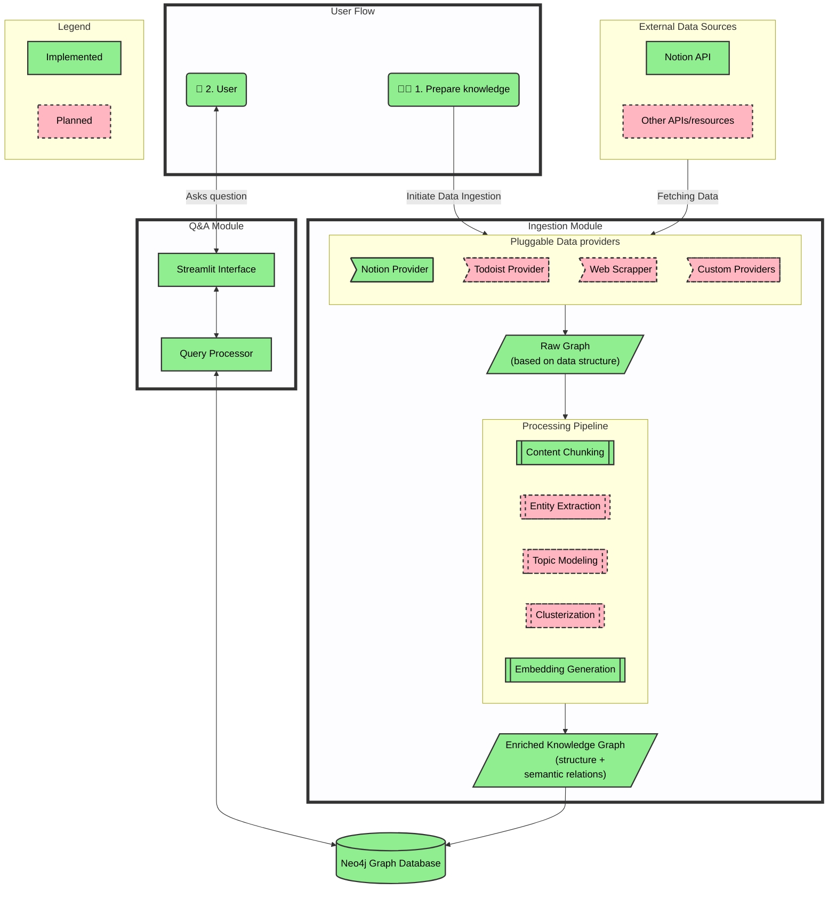

# Knowledge Nexus: Your AI-Powered Personal Knowledge Discovery Engine

## 🛠 Getting Started

### Running Data Ingestion:

#### Using Python environment

1. install neo4j
2. install python
3. make and configure `.env` in the root directory from `.env.example`
4. adjust options in `config/config.yaml` if necessary
5. `pip install -r requirements.txt`
6. `python main.py`

#### Alternative: Using docker-compose 

1. install docker and docker-compose
2. make and configure `.env` in the root directory from `.env.example`
3. adjust options in `config/config.yaml` if necessary
4. run `docker-compose up -d --build` from the root
 

> ⚠️ Current cache limitations:
> - **Notion-API cache:** Designed for session scope caching, using FS cache with long TTL will prevent fetching updated pages
> - **Processed pages and links cache:** Designed for rapid test and development. Prevents sync or removal of already processed and cached pages and links from the graph

### Running Q&A app:

1. Prerequisites: running Neo4j instance with processed data
2. `pip install -r requirements.txt`
3. `python -m streamlit run app_st.py`

## 🌟 Project Overview

Knowledge Nexus is an advanced personal knowledge management system that transforms the way individuals organize,
process, and discover insights from their digital content. By leveraging the power of AI and graph databases, this
project addresses the challenge of information overload and disconnected data silos that many knowledge workers face in
today's digital landscape.

Unlike traditional note-taking or knowledge management tools that rely heavily on manual organization, Knowledge Nexus
automates the process of extracting key concepts, generating insights, and creating meaningful connections across your
personal knowledge base.

1. Data Ingestion:

2. Talking to your data graph: 

### High-level architecture:

## 🎯 Key Challenges Addressed

1. **Information Overload**: Knowledge Nexus cuts through the noise by automatically extracting key entities and
   insights from various content sources, helping you focus on what's important.

2. **Manual Processing Overhead**: Traditional tools require significant manual effort to organize and connect
   information. Knowledge Nexus automates this process, saving you time and cognitive effort.

3. **Limited Contextual Understanding**: While tools like Obsidian or Roam Research rely on explicit links, Knowledge
   Nexus uses AI to understand semantic and topical relationships, creating a richer, more nuanced knowledge graph.

4. **Disconnected Data Silos**: By importing and processing data from various sources into a single, interconnected
   knowledge graph, Knowledge Nexus bridges the gaps between your different information repositories.

5. **Difficulty in Discovering New Connections**: The AI-powered system can uncover non-obvious relationships between
   different pieces of information, potentially leading to new insights or ideas that you might have missed.

## 🚀 Key Features

- **Multi-Source Data Integration**: Import content from Notion, Pocket, web pages, and more (extensible architecture
  for adding new sources).
- **AI-Powered Entity and Topic Extraction**: Automatically identify and extract key entities and topics from processed
  content.
- **Intelligent Insight Generation**: Leverage AI to generate concise insights from your personal knowledge base (PKMS).
- **Semantic Knowledge Graph Construction**: Build a comprehensive, interconnected graph of entities, topics, and
  content using Neo4j, reflecting not just explicit links but semantic relationships.
- **Contextual Querying and Exploration**: Easily retrieve relevant content and explore connections within your
  knowledge graph.
- **Personalized Knowledge Assistant**: Tailored to your specific needs and preferences, helping you find tools,
  frameworks, and best practices aligned with your views.

## 📊 Project Status and Roadmap

### ✅ Implemented
- Modular Pipeline for data ingestion, processing, and graph building with configurable caching of processed data.
- [Notion API](https://developers.notion.com/reference/get-database) integration with configurable request caching: Successfully ingesting documents from Notion Knowledge Base (all pages or from specified root page). Repeated ingestion will process only updated pages. 
- Basic Graph Construction: Creating graph connections based on knowledge base organizational structure and explicit page mentions.
- Semantic Search: Implemented content embeddings for advanced search capabilities.
- Basic Streamlit app for querying the graph and visualizing connections.

 
   
Click to see supported Notion Links 🔗

    

| Type                                     | Parse Markdown Text | Parse References | Recursive Parsing |
|------------------------------------------|:-------------------:|:----------------:|:-----------------:|
| **Page Properties**                      |
| Title                                    |          ✅          |        ✅         |         ✅         |
| Rich Text                                |          ✅          |        ✅         |         ✅         |
| Select                                   |          ✅          |       N/A        |        N/A        |
| Status                                   |          ✅          |       N/A        |        N/A        |
| Multi-select                             |          ✅          |       N/A        |        N/A        |
| Number                                   |          ✅          |       N/A        |        N/A        |
| Date                                     |          ✅          |       N/A        |        N/A        |
| People                                   |          ✅          |       N/A        |        N/A        |
| Files                                    |          ✅          |        ❌         |        N/A        |
| Checkbox                                 |          ✅          |       N/A        |        N/A        |
| URL                                      |          ✅          |        ✅         |         ❌         |
| Email                                    |          ✅          |       N/A        |        N/A        |
| Phone Number                             |          ✅          |       N/A        |        N/A        |
| Formula                                  |          ✅          |       N/A        |        N/A        |
| Relation                                 |          ✅          |        ✅         |         ✅         |
| Rollup                                   |          ✅          |       N/A        |        N/A        |
| Created Time                             |          ✅          |       N/A        |        N/A        |
| Created By                               |          ✅          |       N/A        |        N/A        |
| Last Edited Time                         |          ✅          |       N/A        |        N/A        |
| Last Edited By                           |          ✅          |       N/A        |        N/A        |
| Unique ID                                |          ✅          |       N/A        |        N/A        |
| Verification                             |          ✅          |       N/A        |        N/A        |
| **Database Properties**                  |
| Title                                    |          ✅          |        ❌         |         ❌         |
| Rich Text                                |         N/A         |       N/A        |        N/A        |
| Select                                   |          ❌          |       N/A        |        N/A        |
| Multi-select                             |          ❌          |       N/A        |        N/A        |
| Date                                     |         N/A         |       N/A        |        N/A        |
| People                                   |         N/A         |       N/A        |        N/A        |
| Files                                    |         N/A         |       N/A        |        N/A        |
| Checkbox                                 |         N/A         |       N/A        |        N/A        |
| URL                                      |         N/A         |       N/A        |        N/A        |
| Email                                    |         N/A         |       N/A        |        N/A        |
| Phone Number                             |         N/A         |       N/A        |        N/A        |
| Formula                                  |         N/A         |       N/A        |        N/A        |
| Relation                                 |          ❌          |        ❌         |         ❌         |
| Rollup                                   |         N/A         |       N/A        |        N/A        |
| Created Time                             |          ❌          |       N/A        |        N/A        |
| Created By                               |          ❌          |       N/A        |        N/A        |
| Last Edited Time                         |          ❌          |       N/A        |        N/A        |
| Last Edited By                           |          ❌          |       N/A        |        N/A        |
| **Blocks**                               |
| Paragraph                                |          ✅          |        ✅         |         ✅         |
| Heading 1                                |          ✅          |        ✅         |         ✅         |
| Heading 2                                |          ✅          |        ✅         |         ✅         |
| Heading 3                                |          ✅          |        ✅         |         ✅         |
| Bulleted List Item                       |          ✅          |        ✅         |         ✅         |
| Numbered List Item                       |          ✅          |        ✅         |         ✅         |
| To-do                                    |          ✅          |        ✅         |         ✅         |
| Toggle                                   |          ✅          |        ✅         |         ✅         |
| Code                                     |          ✅          |        ✅         |        N/A        |
| Quote                                    |          ✅          |        ✅         |         ✅         |
| Callout                                  |          ✅          |        ✅         |         ✅         |
| Mention (except mentions of page blocks) |          ✅          |        ✅         |        N/A        |
| Equation                                 |          ✅          |       N/A        |        N/A        |
| Bookmark                                 |          ✅          |        ✅         |        N/A        |
| Image                                    |          ✅          |        ❌         |        N/A        |
| Video                                    |          ✅          |        ❌         |        N/A        |
| Audio                                    |          ✅          |        ❌         |        N/A        |
| File                                     |          ✅          |        ❌         |        N/A        |
| PDF                                      |          ✅          |        ❌         |        N/A        |
| Embed                                    |          ✅          |        ✅         |        N/A        |
| Link Preview                             |          ✅          |        ✅         |        N/A        |
| Divider                                  |          ✅          |       N/A        |        N/A        |
| Table of Contents                        |          ✅          |       N/A        |        N/A        |
| Breadcrumb                               |          ✅          |       N/A        |        N/A        |
| Column List                              |          ✅          |       N/A        |        N/A        |
| Column                                   |          ✅          |       N/A        |        N/A        |
| Synced Block                             |          ✅          |        ✅         |         ✅         |
| Template                                 |          ✅          |        ✅         |         ✅         |
| Link to Page                             |          ✅          |        ✅         |         ✅         |
| Table                                    |          ✅          |       N/A        |        N/A        |
| Table Row                                |          ✅          |       N/A        |        N/A        |
| Child Page                               |          ✅          |        ✅         |         ✅         |
| Child Database (except linked and views) |          ✅          |        ✅         |         ✅         |
| **Comments**                             |          ❌          |        ❌         |         ❌         |

### 🛠️ In Development
- Multi-Source Data Integration: Expanding beyond Notion to include Pocket, web pages, and more. 
Make these integrations easy to plug in. 
- Semantic Layer: Adding connections based on topics and ideas using semantic entity extraction
  - Use core entity/node types (Page, Database, Topic, Person, Location) as well as domain-specific (Project, Task, Tool, Goal)  
- Node Clustering: Implementing clustering for better organization and insight discovery.
- Comprehensive RAG Mechanism: Developing an advanced retrieval-augmented generation system. 
 
Click to see draft implementation details

  1. Generate query questions to the graph from user requests
  2. Retrieve semantically similar pages
  3. Fetch close neighbors of these pages based on semantic proximity
  4. Provide LLM with context from the closest pages (semantically)
  5. Visualize the graph showing found pages, their semantic scores, neighbors, connections, and topic clusters

- Achieve 90%+ test coverage

### 🔮 Future Plans
- Streamlit chat interface with dashboard for visualizing insights and connections (InfraNodus-like).
- Add cross-source coreference resolution to merge the same entities from different sources (leverage string matching, embedding similarity, and context analysis).
  - disambiguate entities with the same name but different meanings. Consider entity context and graph relationships.
- Add evaluation mechanism (langfuse?) for entity extraction and graph building with different models, contexts, and prompts.
- Add evaluation mechanism (RAGAS?) for RAG with different embedding models, query generations, and retrieval flows.
- Dynamic Topic and Cluster Recalculation: Efficiently update topics and clusters upon ingestion of new sources.
- Advanced Visualization: Develop more sophisticated options for exploring the knowledge graph.
- Self-hosted LLM Options: Provide alternatives to OpenAI's API for enhanced privacy.
- Enhanced Personalization: Implement adaptive learning of user preferences and interests.
- Implement token-cost [estimation](https://github.com/AgentOps-AI/tokencost).

## 👥 Who Is It For?

Knowledge Nexus is primarily designed for individual users who:

- Deal with large amounts of information from various sources
- Seek to uncover new insights and connections within their knowledge base
- Want to reduce the cognitive overhead of manual knowledge management
- Are looking for a personal research assistant to aid in complex tasks or decision-making

## 📚 Resources and inspirations

- [Awesome-LLM-KG](https://github.com/RManLuo/Awesome-LLM-KG) - A collection of papers and resources about unifying
  large language models (LLMs) and knowledge graphs (KGs).
- [GraphRAG](https://github.com/microsoft/graphrag) -Microsoft's GraphRAG research paper and implementation

## 🤝 Contributing

Currently, Knowledge Nexus is a personal project, but ideas and suggestions are welcome! Feel free to open an issue for
discussion or submit a pull request with proposed changes.

## 🔒 Privacy and Data Handling

Knowledge Nexus is designed with the privacy in mind. All data is stored locally on your machine. The only external
service used currently is OpenAI's API for AI processing, which is subject to their privacy policy and data handling practices.
Later other LLM adapters will be added including adapters for self-hosted LLMs. 

---

Empower your mind, uncover hidden insights, and navigate your personal sea of knowledge with unprecedented ease. Welcome
to Knowledge Nexus – where your information comes to life!
